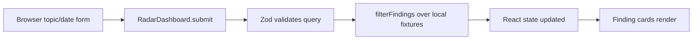
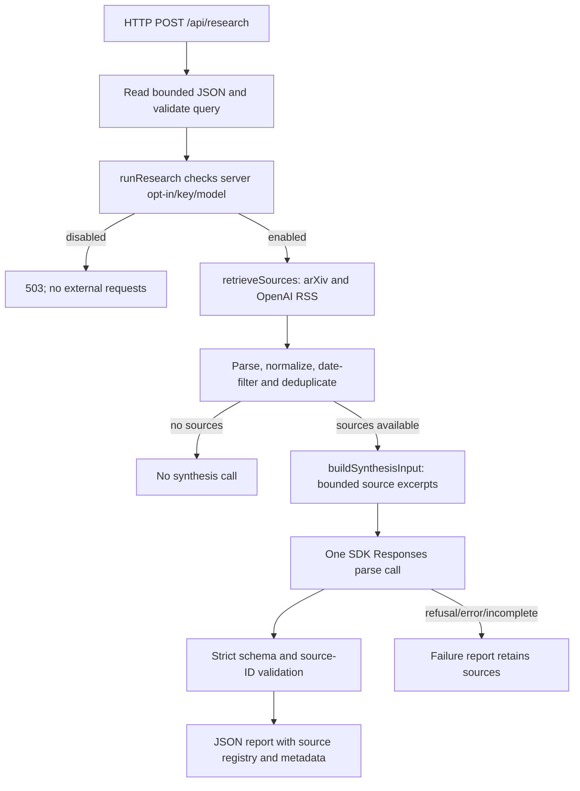

# Reviewing AI Frontier Radar

## What kind of project is this?

Yes: call it a **full-stack Next.js + TypeScript application**. The frontend is React running in the browser. The backend is Node.js API route handlers in the same project. Next.js builds/serves both. Full-stack describes client and server responsibilities; it does not require a database or separate backend repository.

Run npm commands from `06-ai-frontier-radar/`. Shared project memory lives at the repository root. Tests can run without API credentials.

## Current data flow: demo UI



`src/app/page.tsx` renders the dashboard. `src/components/radar-dashboard.tsx` begins with `"use client"`: its state, form handler and local filtering execute in the browser. `src/lib/research.ts` supplies fixture data and the shared query contract. Source links are anchors; clicking them navigates to the publication. **Submitting this UI does not call either backend endpoint or a model.** Paths in this paragraph are application-root-relative.

## Current data flow: server research path (Task 3)



`POST /api/sources` stops after retrieval/normalization and requires no model key. `POST /api/research` adds synthesis but is disabled by default. The API key stays on the server. A future approved UI integration will replace local fixture filtering with a `fetch` to the research API, then render its response. That browser-to-research connection and semantic evidence validation are **not implemented** yet.

## Task 3 map: read in this order

All links below point to actual repository files; look for the named export instead of memorizing line numbers.

| Step | Core file / symbol | Review question |
| --- | --- | --- |
| 1 | [Research route](../06-ai-frontier-radar/src/app/api/research/route.ts), `POST` | Is invalid input rejected before orchestration? What do 200/400/502/503 mean? |
| 2 | [Orchestration](../06-ai-frontier-radar/src/lib/research-run.ts), `runResearch` | Is configuration checked before retrieval? Is the model skipped for zero sources? Are sources retained on model failure? |
| 3 | [Contract](../06-ai-frontier-radar/src/lib/synthesis/schema.ts), `synthesisSchema` | Which fields can the model create? Where are interpretations and proposals separated from claims? |
| 4 | [Synthesis](../06-ai-frontier-radar/src/lib/synthesis/synthesize.ts), `readSynthesisConfig` / `buildSynthesisInput` | What enables spending? How many sources/characters can enter a prompt? Are omissions disclosed? |
| 5 | [Synthesis](../06-ai-frontier-radar/src/lib/synthesis/synthesize.ts), `synthesizeSources` | Is it one SDK call? How are refusals, incomplete output, parsing errors and unknown IDs handled? |
| 6 | [SDK tests](../06-ai-frontier-radar/tests/synthesis.test.ts) | Does the actual SDK parse a mocked HTTP response? Do these tests prove model truthfulness? (No.) |
| 7 | [Pipeline tests](../06-ai-frontier-radar/tests/research-run.test.ts) and [route tests](../06-ai-frontier-radar/tests/research-route.test.ts) | Do failures preserve useful source results without leaking raw exceptions? |

Prior retrieval code is in [retrieve.ts](../06-ai-frontier-radar/src/lib/sources/retrieve.ts) and [normalize.ts](../06-ai-frontier-radar/src/lib/sources/normalize.ts). The browser entry point is [radar-dashboard.tsx](../06-ai-frontier-radar/src/components/radar-dashboard.tsx).

## A practical review workflow

1. Read the outcome/scope and commit boundary. For Task 3 the baseline is `21387ce` (Task 2). Check the diff before opening the entire repository.
2. Read the data contract, then trace a single request through route → orchestration → retrieval → SDK → response. At each boundary ask: who owns this data, what validates it, and what happens when it fails?
3. Review trust boundaries: server-only secrets, untrusted source text, and model output. A valid JSON shape or known source ID does **not** prove the text is supported by evidence. Referenced claims remain `unverified`; empty references are `unsupported`.
4. Read failure tests before implementation details: disabled configuration, no matches, source failure, refusal, incomplete JSON, unknown IDs and upstream errors. Explain each expected behavior in your own words.
5. Run checks, then make one temporary test mutation (without committing it): replace a valid source ID with `invented` and confirm output is rejected. Revert the mutation. This helps demonstrate the guarantee rather than relying on a green test count.
6. Review docs/config/package changes last. Check whether the claimed behavior matches the code and which checks were mocked versus live.

From the repository root:

```sh
git diff --stat 21387ce HEAD
git diff 21387ce HEAD -- 06-ai-frontier-radar/src
git diff 21387ce HEAD -- 06-ai-frontier-radar/tests
```

From the application directory:

```sh
npm run lint
npm run typecheck
npm test
npm run build
npm run test:e2e
```

A passing mocked test proves software behavior for that supplied response. It does not prove account access, paid request success, model quality, citation truth or production scalability. Keep those claims separate in review.

## Safe first manual check

Start `npm run dev` with `ENABLE_LLM_SYNTHESIS=false`. Post a valid topic/date JSON body to `/api/research`: expect 503 and an error code `disabled`, with no upstream retrieval or model request. `/api/sources` remains the public-source-only alternative. Do not enable synthesis merely to inspect the UI; the UI still uses fixtures.

## What to leave for later review

Task 4: evaluate whether evidence supports the claims, beyond ID integrity. Task 5: connect the browser to the validated research pipeline. Task 6: deployment, access/spending controls and demo hardening. These require approval before implementation.
